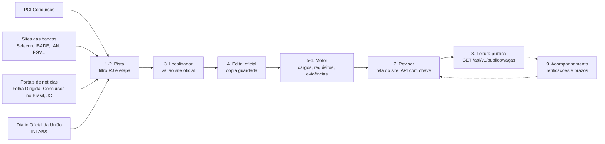

# Como o robô funciona — passo a passo

O sistema procura concursos públicos do Rio de Janeiro (e federais com vaga no RJ), lê o **edital oficial** de cada
um e separa os cargos que um **Técnico Industrial** pode ocupar. Cada dado vem com a prova: a página e o trecho do
edital de onde saiu. **Nada vai para o público sem a aprovação de uma pessoa.** O sistema é uma API: a tela é do site
(veja [../documentacao-api/API.md](../documentacao-api/API.md)).



## O caminho de um concurso

### Passo 1 — Descoberta (a cada hora)

O robô roda sozinho: 2 minutos depois que a aplicação sobe e, a partir daí, a cada hora. Em cada rodada ele lê
quatro tipos de fonte. Nenhuma delas é aceita como prova: elas só dizem **onde procurar** o edital.

| Fonte | O que o robô lê | O que tira dali |
|---|---|---|
| **PCI Concursos** | as listagens Sudeste e Nacional | órgão, UF, vagas, escolaridade e o link da notícia |
| **Sites das bancas** | a página de concursos da Selecon, IBADE, IAN, FGV, Cesgranrio e Instituto Consulplan | o "cartão" de cada concurso: órgão, cidade, situação e o link da página do concurso na banca |
| **Portais de notícias** | o feed RSS da Folha Dirigida (RJ e concursos abertos), do Concursos no Brasil (RJ) e do JC Concursos | título, resumo e link de cada notícia |
| **Diário Oficial da União** | a seção 3 de cada dia, pelo INLABS (precisa de cadastro gratuito) | o texto de cada ato de abertura de concurso |

O **feed RSS** é um arquivo que o próprio portal publica para ser lido por programas (é o que os aplicativos de
notícias usam). Ler o feed é o jeito mais leve e mais educado de acompanhar um portal: uma única requisição por hora
traz as últimas notícias.

### Passo 2 — Filtro: o que interessa vira "pista"

Cada concurso visto vira uma **pista**, guardada no banco. As que não interessam também são guardadas, com o
motivo, para o robô não reavaliá-las e para que dê para conferir depois. Uma pista é descartada quando:

- **não é do RJ**: o texto não cita "RJ", "Rio de Janeiro", "fluminense", um município do estado, uma sigla terminada
  em RJ (CBMERJ, CREMERJ) ou um órgão da lista `orgaos-rj` (UFRJ, Petrobras, Fiocruz...). Os feeds que o portal já
  separa para o RJ (`feeds-rj`) não precisam citar o estado;
- **não é emprego**: vestibular, curso técnico para alunos, residência, estágio;
- **não tem edital aberto**: notícia de previsão, "banca contratada", "deve sair", resultado, gabarito, convocação,
  número de inscritos, material de estudo;
- **é antigo**: concurso encerrado na página da banca, ou notícia com mais de 30 dias;
- **não tem nível técnico** (PCI): a listagem mostra só nível fundamental ou superior.

### Passo 3 — Da pista ao edital oficial

O **localizador** (`LocalizadorEditalOficial`) leva a pista até o PDF do edital. O caminho depende da origem:

- **Notícia (PCI ou portal)**: lê só o texto da notícia, sem propaganda e sem links para outras notícias, e anota os
  sites citados ("inscrições pelo site www.coseac.uff.br"). Procura primeiro nos **sites oficiais** (órgão público ou
  banca conhecida) e só depois nos demais. Links de propaganda, rastreamento e redes sociais são ignorados.
- **Página da banca**: o edital é o melhor PDF da própria página do concurso.
- **Ato do Diário Oficial**: procura nos sites que o texto do ato cita.

Cada PDF achado ganha pontos: "edital" e "abertura", o número do edital e o nome do órgão somam; gabarito, resultado e
convocação subtraem. Retificações e comunicados vistos na mesma página são anotados para o acompanhamento (passo 9).

O robô **nunca** usa a cópia do PDF hospedada num agregador ou portal de notícias.

### Passo 4 — Download

Antes de baixar, o robô lê o **robots.txt** do site (o arquivo em que o site diz o que robôs podem acessar). Se o
site proibir, ou tiver certificado de segurança inválido, ou bloquear o acesso, o robô **não contorna**: a pista vai
para o revisor com o link, para ele baixar pelo navegador e enviar o PDF pela API (`POST /api/v1/pistas/{id}/edital`).

O PDF baixado é guardado com o nome igual à sua impressão digital (sha256). Editais saem do ar; a cópia garante que
dá para mostrar de onde veio cada dado, mesmo anos depois.

### Passo 5 — Leitura do edital (o "motor")

O motor (`motor/`, Java puro, sem banco nem internet) lê o PDF página a página e:

1. acha a estrutura (itens "4.2.3", anexos, tabelas);
2. acha cada cargo e o bloco de texto dele;
3. lê o **requisito de formação** ("curso técnico em Eletrotécnica"), o **conselho** exigido (CRT-RJ, CFT, CREA...),
   salário, vagas, carga horária e taxa;
4. passa tudo pelo **verificador de evidências**: o trecho citado precisa existir na página informada e o valor
   precisa sair do próprio trecho. Se não sair, o campo fica "Não identificado no edital consultado."

### Passo 6 — Classificação

| Classificação | Quando |
|---|---|
| **COMPATÍVEL** | o requisito pede uma formação técnica industrial do catálogo, ou registro em CFT/CRT |
| **POSSIVELMENTE COMPATÍVEL** | "curso técnico em qualquer área", formação ainda não validada no catálogo, ou edital de fonte não confirmada |
| **NÃO COMPATÍVEL** | formação de outra área (ex.: Enfermagem) ou só escolaridade ("ensino médio completo") |
| **NÃO FOI POSSÍVEL CONFIRMAR** | requisito não encontrado ou PDF escaneado (sem texto) |

O nome do cargo não conta: "Técnico em Edificações" que pede só "ensino médio completo" é NÃO COMPATÍVEL. O catálogo
de formações fica em `src/main/resources/catalogo/formacoes.json` e precisa ser validado pelo CRT-RJ.

### Passo 7 — Revisão humana

Na tela de revisão do site (que lê `GET /api/v1/revisao/fila` e `/revisao/cargos/{id}`, com a chave da API), o revisor
vê cada cargo com o trecho do edital ao lado e o PDF aberto na página do requisito. Ele aprova, rejeita, oculta um dado
mal extraído ou corrige a classificação (com justificativa citando página e item): tudo em
`POST /api/v1/cargos/{id}/revisao`. Em `GET /api/v1/revisao/pistas` ficam os concursos em que o robô não chegou ao
edital, com o motivo e o link para o revisor resolver.

### Passo 8 — Leitura pública

`GET /api/v1/publico/vagas` (sem chave) devolve só os cargos **aprovados**, agrupados por concurso, com filtros por
situação, formação e busca. É o que o site mostra ao visitante.

### Passo 9 — Acompanhamento

Depois de analisar um edital, o robô volta à página oficial do concurso a cada 24 horas até a data da prova. Cada
retificação, errata, comunicado, prorrogação ou suspensão nova é lida e vira uma **proposta** em
`GET /api/v1/revisao/alteracoes` (ex.: "prazo de inscrição mudou de 10/10 para 20/10", com o trecho). Nada muda para
o público sem o revisor decidir (`POST /api/v1/alteracoes/{id}/aplicar`).

## Regras que o robô nunca quebra

- Não contorna robots.txt, certificado inválido, captcha, bloqueio (403) nem desafio anti-robô.
- Agregadores e portais de notícias são só descoberta; a prova é sempre o edital oficial.
- Respeita um intervalo mínimo de 2 segundos entre dois acessos ao mesmo site e se identifica como
  `ConcursosTecnicosBot`.
- Senhas e chaves não vão para o log. A chave da API é gerada na 1ª execução (ou definida por variável de ambiente); a
  senha do INLABS só por variável de ambiente.
- Nenhum cargo é publicado sem aprovação.

## Como rodar

**Requisitos:** [JDK 25](https://adoptium.net/temurin/releases/?version=25) e Git. Não precisa instalar o Maven (o
projeto traz o `mvnw`).

```powershell
git clone <endereço do repositório>
cd concursos-tecnicos
.\mvnw.cmd package          # compila e roda os testes
.\rodar-api.ps1             # sobe a API em http://localhost:8080 (documentação: /swagger-ui.html)
```

No Mac ou Linux: `./mvnw package` e depois `./rodar-api.sh`. Passo a passo para Mac e para colocar num servidor
junto do site (Docker, HTTPS, PostgreSQL, variáveis): [IMPLANTACAO.md](IMPLANTACAO.md).

- **Chave da API:** é gerada na 1ª execução e fica em `dados/chave-api.txt`; o servidor do site a envia em `X-API-Key`.
  Para escolher a chave, defina `CONCURSOS_API_CHAVE` (mínimo de 24 caracteres).
- **Banco de dados:** H2 em arquivo em `dados/db` (criado sozinho). Para PostgreSQL, defina `SPRING_DATASOURCE_URL`,
  `SPRING_DATASOURCE_USERNAME` e `SPRING_DATASOURCE_PASSWORD`.
- **Diário Oficial da União:** cadastre-se no [INLABS](https://inlabs.in.gov.br) e defina `CONCURSOS_INLABS_EMAIL` e
  `CONCURSOS_INLABS_SENHA`. Sem elas, essa fonte fica parada e as outras funcionam normalmente.
- **Rodar uma coleta agora** (sem esperar a hora): `POST /api/v1/admin/coletas` (com a chave).
- **Analisar um PDF sem subir a API:** `.\analisar.ps1 C:\editais\edital.pdf` (Mac/Linux: `./analisar.sh edital.pdf`).

A pasta `dados/` (banco, cópias dos PDFs, chave) não vai para o repositório.

## Como acrescentar um site

Tudo fica em `src/main/resources/application.yml`, sem mexer no código. **Antes, abra
`https://<site>/robots.txt`** e confirme que ele permite robôs no endereço que será lido.

**Portal de notícias com feed RSS** (em `concursos.coleta.portais-de-noticias`):

```yaml
- nome: Nome do Portal
  feeds-rj: [https://portal.exemplo/concursos/rj/feed]   # notícias que o portal já separa para o RJ
  feeds: [https://portal.exemplo/feed]                   # país todo: fica o que cita o RJ
```

Acrescente também o domínio em `concursos.fontes.dominios-agregadores`, para que nada vindo dele seja tratado como
fonte oficial.

**Banca organizadora** (em `concursos.coleta.bancas`): a página que lista os concursos e uma expressão regular que
reconhece o link de cada concurso:

```yaml
- nome: Nome da Banca
  listagens: [https://banca.exemplo/concursos]
  link: 'banca\.exemplo/concurso/\d+'
```

Acrescente o domínio em `concursos.fontes.dominios-bancas`, para os editais dela contarem como oficiais.

## Sites avaliados que ficaram de fora

| Site | Motivo |
|---|---|
| QConcursos (www.qconcursos.com) | bloqueia robôs com um desafio anti-robô da Cloudflare, até no robots.txt |
| in.gov.br (DOU pelo site) | recusa conexões de robôs; o DOU é lido pelo INLABS, o acesso automatizado oficial |
| IDECAN, IBFC | recusam robôs |
| AOCP, Cebraspe | a lista de concursos é montada por JavaScript; os concursos chegam pelo PCI e pelos portais |
| CEPUERJ | certificado do site incompleto e PDFs numa pasta que o robots.txt proíbe |
| Selecon (arquivos) | o robots.txt proíbe a pasta dos PDFs: o robô acha o concurso e o revisor baixa o edital |

A Folha Dirigida (folhadirigida.com.br) hoje fica em folha.qconcursos.com, que libera robôs; ela é lida pelo feed.

## Onde está cada passo no código

Pacote base: `src/main/java/br/gov/crtrj/concursos/`.

| Passo | Classes |
|---|---|
| 1. Descoberta | `coleta/FontePci`, `coleta/FonteBancas`, `coleta/FonteNoticias`, `coleta/dou/FonteDou` (todas implementam `FonteDescoberta`) |
| 2. Filtro | nas próprias fontes; `coleta/RegiaoRj` decide o que é do RJ |
| 1–4. Rodada | `coleta/ServicoColeta` (agendado por `coleta/ColetaAgendada`) |
| 3. Localizador | `coleta/LocalizadorEditalOficial`; `fontes/ValidadorFontes` diz o que é oficial |
| 4. Download | `coleta/ClienteWebHttp` (robots.txt em `coleta/RegrasRobots`), `documentos/` |
| 5–6. Motor | `motor/` (`AnalisadorEdital`, `extracao/`, `evidencia/`, `classificacao/`) |
| 7. Revisão | `api/RevisaoController`, `api/AcompanhamentoController`, `api/CargoController` (decisão); dados em `servico/ServicoVisaoRevisor`, `servico/ServicoAlteracoes`, `servico/ServicoRevisao` |
| 8. Leitura pública | `api/VagasPublicasController`, `servico/ServicoVagasPublicas` |
| 9. Acompanhamento | `coleta/ServicoAcompanhamento`, `motor/alteracoes/` |
| Banco | `persistencia/`, migrações em `src/main/resources/db/migration/` |

Os testes ficam em `src/test/java` e rodam com `.\mvnw.cmd test`. Nenhum deles acessa a internet: as páginas e os
PDFs são simulados.
