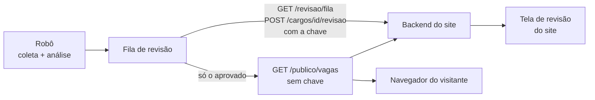

# API — como o site usa

O sistema é só uma API: ele procura os editais, analisa, guarda a prova de cada dado e entrega JSON. A tela é do site.



| Acesso | Rotas | Quem chama |
|---|---|---|
| **Aberto** | `GET /api/v1/publico/**` | o navegador do visitante, ou o backend do site |
| **Com chave** | todo o resto de `/api/v1/**` | **só o backend do site** |

Nada que não foi aprovado por uma pessoa sai pela rota aberta. A chave não vai para o navegador: as rotas que a exigem
não aceitam CORS, então nenhum navegador as chama de outro site, mesmo com a chave.

## Subir e testar

```powershell
.\mvnw.cmd -DskipTests package   # sempre que o código mudar
.\rodar-api.ps1                  # http://localhost:8080  (Mac/Linux: ./rodar-api.sh)
```

```sh
curl http://localhost:8080/api/v1/publico/vagas                                       # aberto
curl -H "X-API-Key: $(cat dados/chave-api.txt)" http://localhost:8080/api/v1/status   # com a chave
```

Documentação interativa com todas as rotas: `http://localhost:8080/swagger-ui.html`. O botão **Authorize** recebe a
chave. Enquanto o site não tiver a tela de revisão, dá para aprovar cargos por ali.

## Chave e CORS

| O quê | Como |
|---|---|
| Chave | cabeçalho `X-API-Key: <chave>`. Na 1ª execução é gerada e gravada em `dados/chave-api.txt` (não vai para o log). Para escolher: variável `CONCURSOS_API_CHAVE`, **mínimo de 24 caracteres** (a API não sobe com menos). Gerar: `openssl rand -base64 32` |
| Trocar a chave | mude a variável (ou o arquivo) e reinicie a API; atualize o backend do site |
| Guardar | só no servidor do site (variável de ambiente ou cofre de segredos). Nunca no JavaScript do navegador nem no repositório |
| CORS | só em `GET /api/v1/publico/**`, para as origens de `CONCURSOS_ORIGENS_PERMITIDAS` (ex.: `https://seusite.org.br`; várias, separadas por vírgula; `*` libera todas). Vazio = nenhuma: o site só lê pelo servidor |

Sem a chave (ou com chave errada) a resposta é `401`. Ver [Erros](#erros).

## Convenções

- JSON em UTF-8. Campos de data (`inscricaoFim`, `conferidoEm`) vêm em ISO (`2026-10-15`); `ultimaBusca` vem em ISO sem fuso
  (horário do servidor). Já os textos de exibição vêm prontos em pt-BR: `inscricoes` ("10/09/2026 a 15/10/2026"),
  `salarioBase` ("R$ 4.250,00"), `vagas` ("8 + cadastro reserva (ampla concorrência: 7; PcD: 1)").
- **Dois textos fixos** aparecem no lugar de um dado: **"Não identificado no edital consultado."** (o edital não traz) e
  **"Confira no edital."** (o revisor ocultou porque a extração estava errada). Mostre-os como vieram.
- Salário-base não é remuneração total, e o valor de uma tabela sem rótulo vem como "(o edital não diz se é salário-base
  ou remuneração total)". Não "arrume" isso no site.
- Códigos estáveis (para lógica) e rótulos (para tela): `classificacao` = `COMPATIVEL` | `POSSIVELMENTE_COMPATIVEL`,
  `classificacaoRotulo` = "COMPATÍVEL"; `situacao` = `INSCRICOES_ABERTAS`, `PROVA_MARCADA`..., `situacaoRotulo` = "Inscrições abertas".
- O texto que vem de editais é **conteúdo não confiável**: mostre com `textContent`, nunca como HTML, e só crie link para
  `http(s)`. O exemplo [`vagas.html`](exemplos/vagas.html) faz isso.
- Listas sem paginação na rota aberta (são poucas vagas); `/cargos`, `/concursos` e `/pistas` paginam com `page` e `size`.

## Leitura pública

### `GET /api/v1/publico/vagas`

Sem chave. Concursos com o prazo de inscrição mais próximo primeiro.

| Parâmetro | Valores |
|---|---|
| `situacao` | `abertas` (padrão) ou `todas` (inclui inscrições encerradas). Suspenso aparece nas duas |
| `formacao` | nome exato de uma formação, como vem em `formacoes` na resposta (ex.: `Técnico em Eletrotécnica`) |
| `busca` | texto livre: cargo, especialidade, concurso, órgão ou município (sem acento e sem diferenciar maiúsculas) |

A resposta traz `Cache-Control: public, max-age=60`: uma aprovação, rejeição ou "desfazer" leva até 1 minuto para valer
para quem já tem a resposta em cache. Use o cache do navegador ou do seu servidor em vez de chamar a cada visita.

```json
{
  "concursos": [{
    "id": 1,
    "nome": "PREFEITURA MUNICIPAL DE NITERÓI – Edital nº 01/2026",
    "orgao": "PREFEITURA MUNICIPAL DE NITERÓI",
    "local": "NITERÓI/RJ",
    "banca": "Fundação Getulio Vargas (FGV)",
    "situacao": "INSCRICOES_ABERTAS",
    "situacaoRotulo": "Inscrições abertas",
    "emAberto": true,
    "inscricoes": "10/09/2026 a 15/10/2026",
    "inscricaoFim": "2026-10-15",
    "alertaPrazo": "Inscrições terminam em 3 dias",
    "prova": "Confira no edital.",
    "siteInscricao": "https://conhecimento.fgv.br/concursos/niteroi26",
    "editalUrl": "https://www.niteroi.rj.gov.br/editais/01-2026.pdf",
    "editalNome": "Edital nº 01/2026",
    "editalOficial": true,
    "documentosPosteriores": [
      { "nome": "EDITAL DE RETIFICAÇÃO Nº 01 AO EDITAL Nº 01/2026", "url": "https://…/retificacao.pdf", "data": "2026-10-02" }
    ],
    "vagas": [{
      "id": 1,
      "cargo": "TÉCNICO DE MANUTENÇÃO – ELETROTÉCNICA",
      "classificacao": "COMPATIVEL",
      "classificacaoRotulo": "COMPATÍVEL",
      "ajustadaNaRevisao": false,
      "classificacaoMotor": "COMPATIVEL",
      "classificacaoMotorRotulo": "COMPATÍVEL",
      "justificativa": "O requisito do cargo (Edital nº 01/2026, p. 1, item 2.1) exige “…”. Técnico em Eletrotécnica consta no catálogo como formação técnica industrial.",
      "formacoes": ["Técnico em Eletrotécnica"],
      "escolaridade": null,
      "requisito": { "texto": "REQUISITOS: Certificado de conclusão de Curso Técnico em Eletrotécnica, …", "local": "p. 1, item 2.1" },
      "vagas": "8 + cadastro reserva (ampla concorrência: 7; PcD: 1)",
      "salarioBase": "R$ 4.250,00",
      "remuneracaoTotal": "R$ 5.180,00",
      "cargaHoraria": "40 horas semanais",
      "taxa": "R$ 75,00",
      "conselho": [
        "Registro exigido: Sim",
        "O edital cita: “Conselho Regional dos Técnicos Industriais”",
        "Exige especificamente o CRT-RJ: Não informado"
      ],
      "conselhoTrecho": { "texto": "REQUISITOS: …", "local": "p. 1, item 2.1" },
      "conferidoEm": "2026-11-03"
    }]
  }],
  "totalVagas": 1,
  "formacoes": ["Técnico em Eletrotécnica"],
  "ultimaBusca": "2026-11-03T09:00:00"
}
```

Campos a que vale atenção:

- `situacao` é `null` e `situacaoRotulo` é "Confira as datas no edital" quando o revisor ocultou as datas.
- `siteInscricao` é `null` quando o revisor ocultou o endereço.
- `ajustadaNaRevisao: true`: uma pessoa publicou com classificação diferente da do robô; `justificativa` é a dela, com
  página e item do edital. Mostre as duas classificações (`classificacaoMotorRotulo` e `classificacaoRotulo`).
- **Exige especificamente o CRT-RJ**: o sistema nunca presume. "Conselho competente" não vira CRT-RJ.
- `editalUrl` é o endereço no site oficial. A cópia guardada do PDF só é servida com chave (revisão).

## Revisão (com chave)

A tela de revisão do site usa estas rotas, **chamadas pelo backend do site**. Nada aprovado aqui aparece na leitura
pública antes de `POST /api/v1/cargos/{id}/revisao` com `APROVADA`.

Fluxo de um cargo:

1. `GET /api/v1/revisao/fila` → lista; `abas[].total` dá o contador de cada aba.
2. `GET /api/v1/revisao/cargos/{id}` → cada dado extraído com o trecho do edital (`evidenciasCargo`, `evidenciasConcurso`),
   o que o robô não achou (`naoIdentificados`), alertas, e `previa`: cada dado **como o público vai ler**.
3. Mostrar o PDF na página `paginaInicial`: o backend repassa `GET /api/v1/documentos/{documento.id}/arquivo` e o
   navegador abre com `#page=N` (o navegador não pode chamar a API direto: ela exige a chave).
4. `POST /api/v1/cargos/{id}/revisao` → decisão.
5. Em até 1 minuto, a leitura pública reflete.

| Método e rota | O que faz |
|---|---|
| `GET /api/v1/revisao/fila?aba=` | `pendentes` (padrão: inscrições abertas primeiro, pelo prazo mais próximo), `nao-compativeis` (o que o robô descartou, para conferir), `aprovadas`, `rejeitadas`. Traz também `coleta`: estado do robô |
| `GET /api/v1/revisao/cargos/{id}` | o cargo para revisar (item 2 acima) |
| `POST /api/v1/cargos/{id}/revisao` | decisão (abaixo). `204` |
| `GET /api/v1/documentos/{id}/arquivo` | PDF guardado (`application/pdf`). Use `#page=N` |

Decisão:

```json
{
  "decisao": "APROVADA",
  "classificacao": "COMPATIVEL",
  "justificativa": null,
  "ocultar": ["SALARIO_BASE", "PROVA"],
  "observacao": "Conferido no PDF"
}
```

| Campo | Regra |
|---|---|
| `decisao` | `APROVADA` (publica), `REJEITADA` (nunca aparece) ou `PENDENTE` (desfaz a decisão: sai do público e volta à fila) |
| `classificacao` | só na aprovação: `COMPATIVEL` ou `POSSIVELMENTE_COMPATIVEL`. Vazio = a do robô |
| `justificativa` | **obrigatória** se `classificacao` difere da do robô: pública, citando página e item do edital. Não dá para publicar um cargo que o robô classificou como `NAO_COMPATIVEL` ou `NAO_FOI_POSSIVEL_CONFIRMAR` sem escolher a classificação e justificar |
| `ocultar` | dados mal extraídos que não vão ao público (aparece "Confira no edital."): `FORMACOES`, `VAGAS`, `SALARIO_BASE`, `REMUNERACAO`, `CARGA_HORARIA`, `TAXA`, `CONSELHO`, e, valendo para o concurso inteiro, `INSCRICOES`, `PROVA`, `BANCA`, `SITE_INSCRICAO` |
| `observacao` | anotação interna (até 1000 caracteres); nunca vai para a leitura pública |

### Retificações, prorrogações e comunicados

O robô volta à página oficial de cada concurso a cada 24 horas e propõe mudanças. Nada muda para o público até a decisão.

| Método e rota | O que faz |
|---|---|
| `GET /api/v1/revisao/alteracoes` | `grupos[]` por concurso, cada item com `rotulo`, `antes`, `depois`, `trecho`, `pagina`, e `acao`: `APLICAR` (muda o concurso ou lista o documento), `CARGO` (pode reabrir o cargo citado) ou `VER` (informativa). Traz também `concursos[]`: a página oficial acompanhada de cada um |
| `POST /api/v1/alteracoes/{id}/aplicar` | novo prazo, nova data de prova, suspensão/cancelamento, ou lista o documento no concurso. `204` |
| `POST /api/v1/alteracoes/{id}/vista` | só informativa. `204` |
| `POST /api/v1/alteracoes/{id}/descartar` | nada muda. `204` |
| `POST /api/v1/alteracoes/{id}/reabrir-cargo` | o cargo publicado foi citado: sai do público e volta à fila. `204` |
| `PUT /api/v1/concursos/{id}/pagina-oficial` | `{"url": "https://…"}`: página onde o robô procura retificações. `204` |
| `POST /api/v1/concursos/{id}/verificacoes` | manda o robô visitar agora, em segundo plano. `202` |
| `POST /api/v1/concursos/{id}/documentos` | informa uma retificação por `{"url": "…", "fonteOficial": true}` ou envia o PDF em multipart (`arquivo`, `urlOrigem`, `fonteOficial`). `{"alteracoesParaRevisar": n}` |

### Concursos que o robô não resolveu (pistas)

| Método e rota | O que faz |
|---|---|
| `GET /api/v1/revisao/pistas` | pistas à espera de uma pessoa, com `status`, `situacao`, `motivo` e a página onde o concurso foi visto, mais o estado do robô |
| `POST /api/v1/pistas/{id}/edital` | informa o edital: JSON `{"url": "…", "fonteOficial": true}` ou multipart (`arquivo`, `urlOrigem`, `fonteOficial`). Para pista `BLOQUEADA` (o site proíbe robôs), baixe o PDF pelo navegador e envie. Devolve a análise: cargos que entraram na fila |
| `POST /api/v1/pistas/{id}/descartar` | o robô não tenta mais. `204` |
| `POST /api/v1/admin/coletas` | roda uma coleta agora, em segundo plano. `202`, ou `409` se já houver uma |
| `GET /api/v1/admin/coletas` | execuções recentes |

## Consulta completa (com chave)

Para relatórios e auditoria; devolvem também o que ainda não foi aprovado.

| Rota | O que traz |
|---|---|
| `GET /api/v1/cargos` | busca com filtros (`uf`, `municipio`, `formacao`, `especialidade`, `salarioMin`, `salarioMax`, `conselho`, `aceitaCrt`, `status`, `cadastroReserva`, `vagasImediatas`, `banca`, `orgao`, `esfera`, `inscricaoAte`, `classificacao`, `page`, `size`); `formato=markdown` devolve o relatório |
| `GET /api/v1/cargos/{id}`, `/{id}/evidencias` | análise completa; evidência campo a campo (documento, página, item, trecho) |
| `GET /api/v1/concursos`, `/{id}`, `/{id}/documentos`, `/{id}/alteracoes` | concursos, seus documentos e o histórico |
| `POST /api/v1/documentos` | analisa um edital por URL ou arquivo |
| `GET /api/v1/documentos/{id}/analise` | JSON completo da análise |
| `GET /api/v1/formacoes`, `/api/v1/status` | catálogo de formações; versão do extrator e contagens |

## Erros

Todo erro é JSON `application/problem+json` (RFC 9457): `status` (número), `title`, `detail` e `instance`. Decida pelo
`status`; `detail` é para mostrar a quem opera ou para o log.

```json
{ "type": "about:blank", "title": "Pedido inválido", "status": 400,
  "detail": "aba deve ser uma de: pendentes, nao-compativeis, aprovadas, rejeitadas.", "instance": "/api/v1/revisao/fila" }
```

| `status` | Quando |
|---|---|
| `400` | parâmetro ou corpo inválido; regra de revisão violada (ex.: classificar sem justificar); alteração já decidida |
| `401` | chave ausente ou errada (cabeçalho `WWW-Authenticate: ApiKey`) |
| `403` | `Origin` não permitida em `/api/v1/publico/**` (CORS) |
| `404` | cargo, concurso, pista, documento ou alteração inexistente; rota inexistente |
| `409` | já existe uma coleta em andamento |
| `422` | o documento informado não pôde ser baixado ou lido (não é PDF, site fora do ar, arquivo corrompido) |
| `500` | erro inesperado (o detalhe fica no log, não na resposta) |

Os erros do próprio Spring (JSON ilegível, tipo de parâmetro errado) têm o `detail` em inglês.

## Exemplos de consumo

### 1. Navegador: listar as vagas (sem chave)

[`exemplos/vagas.html`](exemplos/vagas.html) é uma página completa, com filtros, que lê a rota aberta e
mostra tudo com segurança. Para rodar: sirva a pasta de qualquer jeito (a página não abre bem por `file://`, que tem
origem `null`) e abra `?api=http://localhost:8080`. A origem de onde a página é servida precisa estar em
`CONCURSOS_ORIGENS_PERMITIDAS`:

```sh
CONCURSOS_ORIGENS_PERMITIDAS=http://localhost:3000 ./rodar-api.sh
```

O essencial:

```js
const API = "https://api.seusite.org.br";

const r = await fetch(`${API}/api/v1/publico/vagas?situacao=abertas&busca=${encodeURIComponent("manutenção")}`);
if (!r.ok) throw new Error((await r.json()).detail);            // erros: {status, title, detail}
const { concursos, totalVagas, formacoes } = await r.json();

for (const c of concursos) {
  console.log(c.nome, c.situacaoRotulo, c.inscricoes, c.alertaPrazo ?? "");
  for (const v of c.vagas) console.log("  ", v.cargo, v.classificacaoRotulo, v.salarioBase);
}
```

### 2. Backend do site: revisão (com chave)

[`exemplos/backend-do-site.mjs`](exemplos/backend-do-site.mjs) (Node 18+, sem dependências) é um
servidor de exemplo que guarda a chave e repassa só as rotas da tela de revisão, inclusive o PDF. O navegador do
revisor fala com ele, e só ele fala com a API.

```sh
CONCURSOS_API_URL=http://localhost:8080 CONCURSOS_API_CHAVE=$(cat dados/chave-api.txt) \
REVISOR_TOKEN=um-segredo node exemplos/backend-do-site.mjs
```

O núcleo, para levar para o backend que o site já tem (a chave sai do ambiente do servidor, nunca do navegador):

```js
const API = process.env.CONCURSOS_API_URL;
const CHAVE = process.env.CONCURSOS_API_CHAVE;

// uma rota do seu backend, atrás do login do revisor que o site já tem
app.post("/revisao/cargos/:id/decisao", exigeRevisor, async (req, res) => {
  const r = await fetch(`${API}/api/v1/cargos/${Number(req.params.id)}/revisao`, {
    method: "POST",
    headers: { "X-API-Key": CHAVE, "Content-Type": "application/json" },
    body: JSON.stringify(req.body),     // {decisao, classificacao, justificativa, ocultar, observacao}
  });
  // 204 = feito; 400 traz o motivo em detail (ex.: "escreva a justificativa citando a página e o item")
  res.status(r.status).type(r.headers.get("content-type") ?? "application/json").send(Buffer.from(await r.arrayBuffer()));
});
```

### 3. curl: o caminho completo

```sh
API=http://localhost:8080; K=$(cat dados/chave-api.txt)

# 1. mandar um edital (ou espere o robô achar sozinho)
curl -H "X-API-Key: $K" -F arquivo=@edital.pdf -F urlOrigem=https://www.prefeitura.rj.gov.br/edital.pdf $API/api/v1/documentos

# 2. ver a fila e um cargo com os trechos do edital
curl -H "X-API-Key: $K" "$API/api/v1/revisao/fila"
curl -H "X-API-Key: $K" "$API/api/v1/revisao/cargos/1"

# 3. aprovar, ocultando a data da prova que veio errada
curl -X POST -H "X-API-Key: $K" -H "Content-Type: application/json" \
     -d '{"decisao":"APROVADA","ocultar":["PROVA"]}' $API/api/v1/cargos/1/revisao

# 4. o público já vê (sem chave)
curl "$API/api/v1/publico/vagas?situacao=todas"
```

## Do painel antigo para a API

| Antes (painel) | Agora |
|---|---|
| página `/` | `GET /api/v1/publico/vagas` |
| `/revisao`, `/revisao/cargos/{id}` | `GET /api/v1/revisao/fila`, `GET /api/v1/revisao/cargos/{id}` |
| botões aprovar / rejeitar / desfazer | `POST /api/v1/cargos/{id}/revisao` com `decisao` |
| PDF no quadro ao lado | `GET /api/v1/documentos/{id}/arquivo` (via backend do site) |
| `/revisao/pistas` e formulários | `GET /api/v1/revisao/pistas`, `POST /api/v1/pistas/{id}/edital` e `/descartar` |
| `/revisao/alteracoes` e botões | `GET /api/v1/revisao/alteracoes`, `POST /api/v1/alteracoes/{id}/…`, `PUT/POST /api/v1/concursos/{id}/…` |
| botão "Buscar agora" | `POST /api/v1/admin/coletas` |
| login `admin` + `dados/senha-painel.txt` / `CONCURSOS_PAINEL_SENHA` | `X-API-Key` + `dados/chave-api.txt` / `CONCURSOS_API_CHAVE` |

A cópia antiga `dados/senha-painel.txt` não é mais usada. Na 1ª execução da versão nova, a chave é gerada em
`dados/chave-api.txt`; o banco e os PDFs em `dados/` continuam como estavam (sem migração).
